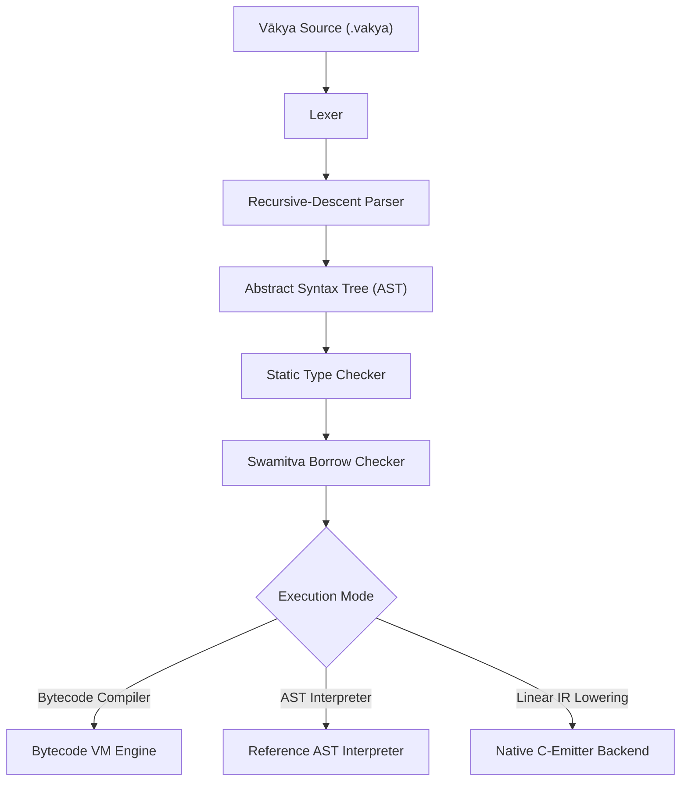

# VĀKYA (वाक्य)

### *Romanized Sanskrit Programming Language*

[](https://github.com/vakya-lang/vakya/actions/workflows/ci.yml)
[](LICENSE)
[](https://github.com/vakya-lang/vakya/releases)
[](https://www.python.org/)
[](docs/testing.md)

---

## 🌟 What is Vākya?

**Vākya** (*vā-kya* / वाक्य — Sanskrit for *Sentence* or *Statement*) is an open-source programming language combining **Romanized Sanskrit vocabulary** with **modern systems programming architecture**.

Vākya brings linguistic elegance and deterministic grammar to programming while providing modern static type checking, compile-time memory safety (**Swamitva**), a high-speed Bytecode Virtual Machine, and native compilation targets.

---

## 🚀 Key Features

* **Romanized Sanskrit Keywords**: Standard Latin script keywords (`chara`, `dhruva`, `karya`, `yadi`, `yavat`, `aayat`) designed for universal keyboard typing without requiring specialized IME input.
* **Static Typing & Inference**: Type checking with local type inference supporting `sankhya` (integers), `dashamika` (floats), `shabda` (strings), `boolean`, `suchi` (lists), and `naksha` (maps).
* **Swamitva Memory Safety**: Compile-time ownership and borrow checker preventing use-after-move bugs (`E501`), mutable alias conflicts (`E502`/`E503`), and dangling references without runtime garbage collection pauses.
* **Dual Execution Targets**:
  * ⚡ **Bytecode Virtual Machine**: Flat integer opcode stack machine with call frame caching for fast execution.
  * 🔬 **AST Interpreter**: Tree-walking reference engine for specification compliance and differential verification.
  * 🛠️ **Native C-Emitter Backend**: AOT compilation producing standalone C code for native binaries.
* **Standard Library & Module System**: `aayat` imports with built-in modules for mathematics (`math`), string manipulation (`string`), I/O (`io`), and timing (`time`).
* **Rich Developer Tooling**: Integrated code runner (`vakya run`), type checker (`vakya check`), code formatter (`vakya fmt`), interactive REPL (`vakya repl`), project scaffolder (`vakya new`), and diagnostic doctor (`vakya doctor`).
* **Dual-Mode Desktop GUI Launcher**: Windows executable that opens a rich desktop IDE launcher on double-click while remaining a zero-overhead CLI in the terminal.

---

## ⚡ Quick Start

### 1. Installation

#### Option A: Download Standalone Executable (Windows x64)
Download the latest pre-compiled `vakya.exe` or `Vakya-v0.1.0-Windows-x64.zip` from [**GitHub Releases**](https://github.com/vakya-lang/vakya/releases). No Python or Git required!

#### Option B: Install from Source (Cross-Platform)
```bash
git clone https://github.com/vakya-lang/vakya.git
cd vakya
python3 -m venv .venv
source .venv/bin/activate  # On Windows: .\.venv\Scripts\Activate.ps1
pip install -e ".[dev]"
```

Verify your installation:
```bash
vakya --version
vakya doctor
```

---

## 📖 Your First Program

Create a file named `hello.vakya`:

```vakya
// hello.vakya
vada("Namaste Vākya")
```

Run it via the Vākya CLI:
```bash
vakya hello.vakya
```

**Output**:
```text
Namaste Vākya
```

---

## 💡 Realistic Language Example: Factorial

```vakya
// factorial.vakya
aayat math

karya factorial(n: sankhya) -> sankhya {
    yadi n <= 1 {
        pratyavartaya 1
    }
    pratyavartaya n * factorial(n - 1)
}

chara num = 10
vada("Factorial of", num, "is:", factorial(num))
vada("Square root of factorial:", math.ghatamula(factorial(num)))
```

Run with the Bytecode VM:
```bash
vakya run factorial.vakya --engine=vm
```

**Output**:
```text
Factorial of 10 is: 3628800
Square root of factorial: 1904.9409439665042
```

---

## 🏛️ Compiler & Runtime Architecture



---

## 🛡️ Swamitva (स्वामित्व) Memory Safety

Vākya enforces compile-time memory safety using single-ownership and exclusive mutable borrowing invariants:

```vakya
chara data = [1, 2, 3]
chara moved_data = data    // Ownership transferred to moved_data

// vada(data)              // Compile Error [E501]: Use of moved value 'data'
vada(moved_data)           // OK: [1, 2, 3]
```

Run the borrow checker on your code:
```bash
vakya check my_program.vakya
```

---

## 🛠️ Command-Line Interface (CLI)

```bash
vakya hello.vakya                         # Execute source file directly
vakya run app.vakya --engine=vm           # Execute with Bytecode VM
vakya check app.vakya                     # Run static type and borrow checks
vakya build app.vakya -o app              # Compile to native C executable
vakya fmt app.vakya --write               # Auto-format source code in place
vakya repl                                # Start interactive REPL
vakya disasm app.vakya                    # Disassemble bytecode instructions
vakya new my_project                      # Scaffold new project directory
vakya doctor                              # System & environment diagnostic check
vakya test                                # Run automated test suite
vakya --gui                               # Launch Desktop GUI Launcher
```

---

## 📚 Documentation Index

| Guide | Description |
| :--- | :--- |
| [**Documentation Hub**](docs/README.md) | Central documentation index and navigation |
| [**Language Specification**](docs/language-spec.md) | Formal language and grammar specification |
| [**Keywords Reference**](docs/keywords.md) | Full catalog of Romanized Sanskrit keywords |
| [**Type System**](docs/type-system.md) | Static types, inference rules, and type checking |
| [**Swamitva Memory Safety**](docs/memory-safety.md) | Ownership, borrowing, and diagnostics `E501`–`E505` |
| [**Standard Library**](docs/stdlib.md) | Standard modules (`math`, `string`, `io`, `time`) |
| [**Module System**](docs/modules.md) | Module resolution and `aayat` imports |
| [**CLI Manual**](docs/cli.md) | Comprehensive CLI reference manual |
| [**Desktop GUI Launcher**](docs/gui.md) | Desktop IDE views and graphical workflow |
| [**Testing Matrix**](docs/testing.md) | Test suite breakdown and differential verification |
| [**Benchmarking**](docs/benchmarks.md) | Performance metrics and execution timings |
| [**Contributing Guide**](CONTRIBUTING.md) | Contributor setup, testing, and pull requests |
| [**Project Roadmap**](ROADMAP.md) | Development milestones and future directions |

---

## 🧪 Testing

Run all 448 automated unit, conformance, and differential tests:

```bash
python -m unittest discover -s tests -p "test_*.py"
```

Or run via the CLI:
```bash
vakya test
```

---

## ⚖️ License

The Vākya programming language is open-source software licensed under the [**MIT License**](LICENSE).
