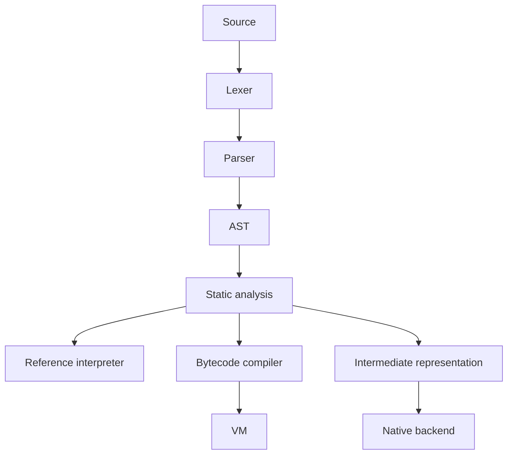

# VĀKYA (वाक्य)

An experimental programming language using Romanized Sanskrit keywords, with a Python-based compiler and runtime toolchain.

[Repository](https://github.com/b7662777-hash/vakya-programming-language) · [Actions](https://github.com/b7662777-hash/vakya-programming-language/actions) · [Language specification](LANGUAGE_SPEC.md) · [Roadmap](ROADMAP.md) · [License](LICENSE)

> **Alpha software:** package metadata identifies version `0.1.0` and development status Alpha. Validate the features you use against this checkout. This README does not claim a verified test count, production readiness, or a formal memory-safety guarantee.

## Why explore Vākya?

Vākya offers a language-engineering playground for studying parsing, static analysis, execution engines, diagnostics, and developer tooling with Sanskrit-inspired vocabulary typed on a standard Latin keyboard.

| Area | Repository components |
| --- | --- |
| Front end | Lexer, parser, AST, language definitions, and diagnostics |
| Analysis | Type-checker components and documented ownership/borrowing rules |
| Execution | Reference interpreter, bytecode components, and VM |
| Compilation | Intermediate-representation and native-backend components |
| Tooling | CLI, formatter, REPL, module support, and GUI components |
| Learning | Examples, benchmarks, showcase material, and tests |

Component presence is not proof that every construct is implemented equivalently across every engine. Consult the specification, tests, and implementation for support details. Performance claims require reproducible measurements.

## Install from this repository

Python **3.12 or newer** is required by `pyproject.toml`. Python 3.12 and 3.13 are listed in the package classifiers; other versions should be tested rather than assumed supported.

```bash
git clone https://github.com/b7662777-hash/vakya-programming-language.git
cd vakya-programming-language
python -m venv .venv
```

```bash
# Linux / macOS
source .venv/bin/activate
```

```powershell
# Windows PowerShell
.\.venv\Scripts\Activate.ps1
```

```bash
python -m pip install -e ".[dev]"
vakya --version
vakya doctor
vakya --help
```

The package exposes `vakya` through `vakya.cli:main`. Development extras include testing and packaging tools. Installation success and command output should be checked locally.

## First program

Create `hello.vakya`:

```text
vada("Namaste Vākya")
```

The existing documentation describes these commands:

```bash
vakya hello.vakya
vakya run hello.vakya --engine=vm
vakya check hello.vakya
```

Expected example output:

```text
Namaste Vākya
```

Check `vakya --help` and subcommand help for the current checkout before relying on additional flags. Run only trusted programs; this README does not claim the interpreter, native output, or GUI is a security sandbox.

## Architecture



This is a conceptual overview of the repository components, not a guarantee of backend equivalence or complete language support.

## Verify your checkout

The project includes both unittest-style discovery instructions and pytest configuration. Pytest is configured to collect from `tests/` and `showcase/`.

```bash
python -m unittest discover -s tests -p "test_*.py"
python -m pytest
```

Record the commit, Python version, test command, and actual results when reporting validation. A successful dependency-update workflow is not equivalent to a passing language-conformance suite. Historical test totals should not be presented as the current checkout's results.

| Check | Purpose |
| --- | --- |
| CLI smoke test | Verify installation and basic program execution |
| Unit tests | Check individual compiler/runtime behaviors |
| Engine comparison | Compare reference and VM results for supported programs |
| Native validation | Compile and execute supported examples with the required native toolchain |
| Benchmarks | Report environment and methodology before comparing speed |

## Documentation

| Resource | Purpose |
| --- | --- |
| [Language specification](LANGUAGE_SPEC.md) | Top-level language reference |
| [Documentation directory](docs/) | Detailed guides and technical material |
| [Examples](examples/) | Sample programs |
| [Tests](tests/) | Automated verification material |
| [Showcase](showcase/) | Demonstrations and additional collection targets |
| [Benchmarks](benchmarks/) | Performance experiments |
| [Contributing](CONTRIBUTING.md) | Contribution process |
| [Authors](AUTHORS.md) | Existing author information |
| [Security](SECURITY.md) | Security guidance |
| [Changelog](CHANGELOG.md) | Change history |
| [Roadmap](ROADMAP.md) | Planned work |

## Repository identity and attribution

You are viewing `b7662777-hash/vakya-programming-language`. Existing package metadata references `vakya-lang/vakya` and credits the Vākya Core Team. Those references are retained here as provenance context, not evidence that this checkout has the same releases, CI results, or authorship history.

Preserve existing author and license notices. Use repository history and contribution records to establish which changes belong to this checkout. Do not describe inherited work as entirely original without evidence. Package metadata URLs have not been changed by this README update.

For binaries, inspect this repository's Releases page and verify any available artifacts before downloading. This README does not promise that a Windows executable or a particular archive is published here.

## Development priorities

| Priority | Improvement |
| --- | --- |
| 1 | Make conformance-test results reproducible for this repository |
| 2 | Document language support and limitations per execution engine |
| 3 | Verify examples and CLI documentation against tests |
| 4 | Publish measured benchmarks with environment details |
| 5 | Align package links with the maintainer's intended repository identity |

## License

See [LICENSE](LICENSE) for the applicable MIT license text. Retain its copyright and attribution notices when redistributing permitted copies.
