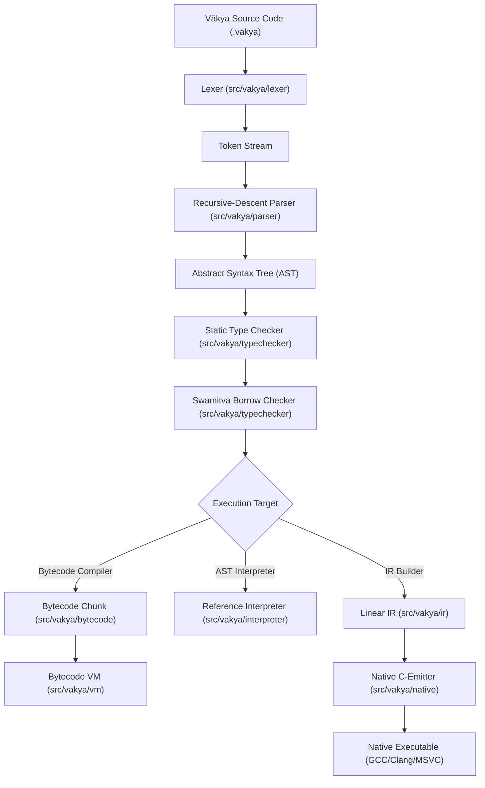

# Vākya System Architecture

This document describes the high-level architecture, subsystem interactions, and execution pipelines of the **Vākya Programming Language**.

---

## 1. High-Level Compilation & Execution Pipeline

Vākya implements a multi-target compiler architecture capable of executing code via a **High-Performance Bytecode VM**, a **Reference Tree-Walking Interpreter**, or a **Native C-Emitter Backend**.

---

## 2. Core Subsystems

### A. Front-End Subsystems
1. **Lexer (`src/vakya/lexer/`)**:
   - Tokenizes UTF-8 Romanized Sanskrit source into structured tokens with precise 1-indexed line and column tracking.
   - Enforces lexer-level security limits (maximum token count, identifier length limit).
2. **Parser (`src/vakya/parser/`)**:
   - Handwritten recursive-descent parser producing strongly-typed AST nodes.
   - Recovers gracefully and generates contextual error diagnostics (`E201`–`E207`).
3. **AST (`src/vakya/ast/`)**:
   - Represents language grammar constructs (Statements, Expressions, Functions, Closures, Loops, Modules).

### B. Static Analysis Subsystems
1. **Type Checker (`src/vakya/typechecker/checker.py`)**:
   - Bidirectional static type checker with type inference.
   - Validates type consistency across expressions, assignments, function returns, and collections (`E401`–`E407`).
2. **Swamitva Borrow Checker (`src/vakya/typechecker/borrow_checker.py`)**:
   - Enforces compile-time memory safety invariants:
     - Affine ownership and single-owner move semantics (`E501`).
     - Exclusive mutable borrow rule: `(&mut T)` cannot alias with `(&T)` or other `(&mut T)` (`E502`, `E503`).
     - Lifetime tracking preventing references from outliving their owner (`E504`).
     - Mutation prohibition on borrowed values (`E505`).

### C. Execution Engines
1. **Bytecode Virtual Machine (`src/vakya/vm/`)**:
   - Stack-based virtual machine with flat integer opcode dispatch.
   - Fast integer arithmetic fast-paths and pooled call frame management.
   - Default engine for high performance in `vakya run`.
2. **AST Interpreter (`src/vakya/interpreter/`)**:
   - Reference tree-walking interpreter directly evaluating AST nodes.
   - Used for differential equivalence testing against the VM.
3. **Native Backend (`src/vakya/native/`)**:
   - Lowers AST through Linear IR into standalone, ANSI-compliant C source code.
   - Links against `runtime/vakya_runtime.h` to produce native Windows/Linux binaries.

### D. User Interface & Tooling
1. **CLI Dispatcher (`src/vakya/cli.py`)**:
   - Command router providing `run`, `check`, `build`, `fmt`, `repl`, `disasm`, `doctor`, and `new`.
2. **Desktop GUI Launcher (`src/vakya/gui/`)**:
   - Dual-mode launcher with high-DPI desktop environment, editor, REPL, documentation reader, and examples explorer.
