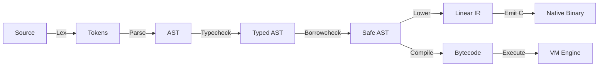

# Vākya Compiler Architecture & Internals

This document provides a deep technical walkthrough of the **Vākya Compilation Pipeline**, covering lexical analysis, parsing, type checking, memory safety analysis, intermediate representation (IR), bytecode generation, and native compilation.

---

## 1. Pipeline Stages



---

## 2. Front-End: Lexing & Parsing

### Lexical Tokenization (`src/vakya/lexer/`)
The lexer converts raw UTF-8 Romanized Sanskrit source into a structured token stream. Identifiers and keywords are matched against the canonical keyword registry:

```vakya
chara sankhya_var = 42
```
Yields tokens:
1. `TOKEN_CHARA` (Line 1, Col 1)
2. `TOKEN_IDENTIFIER("sankhya_var")` (Line 1, Col 7)
3. `TOKEN_EQUAL` (Line 1, Col 19)
4. `TOKEN_NUMBER(42)` (Line 1, Col 21)

### Recursive-Descent Parsing (`src/vakya/parser/`)
The parser constructs an Abstract Syntax Tree (AST) using standard operator precedence (Pratt parsing for expressions and recursive descent for statements):

```python
VarDeclaration(
    name="sankhya_var",
    type_annotation=None,
    initializer=NumberLiteral(value=42),
    is_constant=False
)
```

---

## 3. Static Type Checking & Swamitva Memory Safety

### Type Checking (`src/vakya/typechecker/checker.py`)
Static types are inferred or explicitly declared using Romanized Sanskrit type names:
- `sankhya` (Integer)
- `dashamika` (Float)
- `shabda` (String)
- `boolean` (Boolean)
- `suchi` (List)
- `naksha` (Map)
- `shunya` (Null / Void)

### Swamitva Borrow Checking (`src/vakya/typechecker/borrow_checker.py`)
Swamitva tracks variable ownership and active borrows:
- **Move Semantics**: Assigning or passing non-primitive values transfers ownership. Using a moved variable emits error `E501`.
- **Borrow Exclusivity**: Multiple shared borrows (`&T`) are permitted simultaneously, but a mutable borrow (`&mut T`) must be strictly unique (`E502`, `E503`).
- **Mutation Invariant**: Variables cannot be mutated while active borrows exist (`E505`).

---

## 4. Bytecode Compilation & Virtual Machine

### Bytecode Compiler (`src/vakya/bytecode/compiler.py`)
Translates the validated AST into flat chunks consisting of bytecode instructions, constant pools, and jump tables:

| Opcode | Mnemonic | Description |
| :--- | :--- | :--- |
| `0x01` | `OP_CONSTANT` | Push constant from constant pool onto operand stack |
| `0x02` | `OP_POP` | Discard top of stack |
| `0x03` | `OP_ADD` | Pop 2 values, push sum |
| `0x04` | `OP_SUB` | Pop 2 values, push difference |
| `0x05` | `OP_MUL` | Pop 2 values, push product |
| `0x06` | `OP_DIV` | Pop 2 values, push quotient (with division-by-zero check) |
| `0x10` | `OP_JUMP` | Unconditional forward jump |
| `0x11` | `OP_JUMP_IF_FALSE` | Pop condition; jump if false |
| `0x14` | `OP_CALL` | Push new call frame and transfer execution |
| `0x15` | `OP_RETURN` | Pop call frame and push return value |
| `0x2A` | `OP_IMPORT_MODULE` | Load and link standard library or external module |

### Virtual Machine (`src/vakya/vm/vm.py`)
The VM evaluates bytecode using a flat instruction pointer (`ip`), value stack, and call stack frame pool:
```text
┌────────────────────────────────────────────────────────┐
│ VirtualMachine                                         │
│ ┌──────────────────────┐   ┌─────────────────────────┐ │
│ │ Value Stack          │   │ Call Stack (Frames)     │ │
│ │ [ 42, "hello" ]      │   │ [ Frame0, Frame1 ]      │ │
│ └──────────────────────┘   └─────────────────────────┘ │
│ ┌────────────────────────────────────────────────────┐ │
│ │ Global Environment & Imported Modules Table        │ │
│ └────────────────────────────────────────────────────┘ │
└────────────────────────────────────────────────────────┘
```

---

## 5. Native C-Emitter Backend (`src/vakya/native/`)

The native compiler emits standalone ANSI C source code:
1. Lowers AST nodes into a 3-address Linear Intermediate Representation (`src/vakya/ir/`).
2. Generates C functions and type definitions linked to `runtime/vakya_runtime.h`.
3. Invokes the host C compiler (`gcc`, `clang`, or `cl.exe`) to produce an executable binary.
